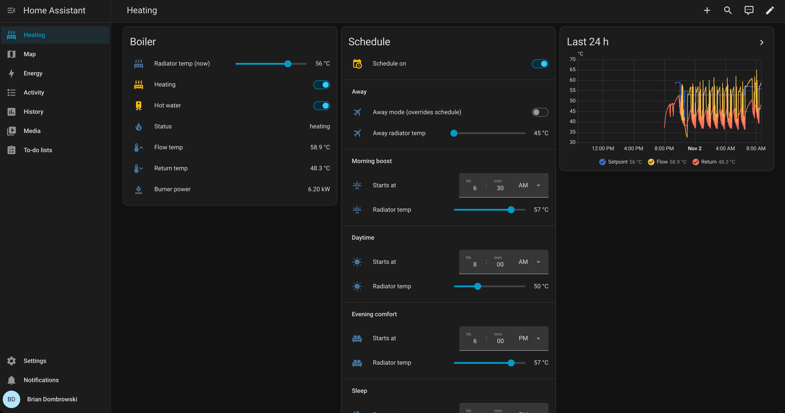

# Ariston Clas HE System EVO 30 in Home Assistant, over eBUS

Read **and control** an Ariston Clas HE System EVO 30 EU gas boiler from Home Assistant using the
[eBUS Adapter Shield C5](https://adapter.ebusd.eu/v6/index.en.html), ebusd and MQTT: live boiler status and
temperatures, a radiator-temperature slider, heating / hot-water switches, a four-period daily schedule, an away mode,
and a one-card dashboard. No Ariston cloud, no Wi-Fi gateway, no thermostat needed.



Everything here was built and verified on one real boiler in November 2026. Treat it as a well-documented starting point
for Ariston "BridgeNet" boilers, not a guarantee for every model.

## Setup this is built and tested on

| Part | What I used |
|---|---|
| **Boiler** | Ariston **CLAS HE SYSTEM EVO 30 EU** - gas *system* boiler (no hybrid, no heat pump), no room thermostat, no outdoor sensor, no Ariston Wi-Fi gateway. Talks Ariston's **BridgeNet / "eBUS2"** dialect (boiler = master `0x37`, slave `0x3c`) |
| **Bus adapter** | [**eBUS Adapter Shield C5**](https://adapter.ebusd.eu/v6/index.en.html) (ESP32-C5, firmware 1.1) on Wi-Fi, **enhanced protocol**, TCP port `9999` |
| **Home Assistant** | Home Assistant OS 2026.10 on a **Raspberry Pi 4 (2 GB)** |
| **ebusd** | The **eBUSd** app from [LukasGrebe/ha-addons](https://github.com/LukasGrebe/ha-addons), ebusd 26.1 |
| **MQTT** | **Mosquitto broker** app + the MQTT integration |
| **Config in this repo** | A trimmed, boiler-only ebusd CSV, one Home Assistant package, helper definitions and a dashboard |

Other Ariston-group boilers (Chaffoteaux Mira / Talia / Serelia, Elco, Genus, Alteas, Cares...) use the same bus dialect,
so the method and much of the register map should carry over, but you must verify each register on your own boiler (see
[Adapting to another boiler](#adapting-to-another-boiler)).

## What you get

- **Live boiler data** (every few seconds): status (`standby` / `heating` / `circulating` / `heating hot water` /
  `low water pressure` / `no flame`...), flow and return temperature, burner power, burner hours, settings-change counter.
- **Controls that write to the boiler**
  - `number.boiler_heating_setpoint` - radiator flow temperature slider (45-60 °C by default; the boiler accepts 35-82 °C)
  - `switch.boiler_heating` - heating on/off (the radiator icon)
  - `switch.boiler_hot_water` - hot water on/off (the tap icon)
- **Schedule** - four periods a day (morning boost, daytime setback, evening comfort, sleep), each with an editable start
  time and temperature, plus a master on/off switch.
- **Away mode** - one switch plus an "away temperature" slider that overrides the schedule.
- **A "Heating" dashboard** - everything above on one screen (three cards that sit side by side on wide screens and
  stack on a phone), favourite-able in the mobile app.
- **Safety rails** - an allow-list of the only three writes ebusd may send, range limits on every slider, read-back after
  every write, writes only when the value actually changes (at most four scheduled writes a day).

Dashboard layout (three cards, shown side by side when they fit, stacked otherwise):

```
Boiler    Radiator temp (now)  [--o-------]  56 °C
          Heating              [on ]    Hot water  [on ]
          Status circulating   Flow 40.5 °C   Return 39.5 °C   Burner 0.0 kW
Schedule  Schedule on [on ]
          Away       Away mode [off]   Away radiator temp [o-----] 45 °C
          Morning boost   Starts at 06:30   Radiator temp 57 °C
          Daytime         Starts at 08:00   Radiator temp 50 °C
          Evening comfort Starts at 18:00   Radiator temp 57 °C
          Sleep           Starts at 22:00   Radiator temp 53 °C
Last 24 h [ setpoint / flow / return history graph ]
```

## How it works

```
Boiler BUS terminals ──2 wires──> Shield C5 ──Wi-Fi──> ebusd app ──MQTT──> Home Assistant
(Ariston BridgeNet)               (enhanced protocol,  (ariston.csv        (package: controls,
                                   port 9999)           decodes/encodes)    schedule, dashboard)
```

- The boiler broadcasts values on the bus (setpoint, status, heat request) and answers reads sent to its address `0x3c`.
- `ebusd/ariston.csv` teaches ebusd the Ariston message format and exposes each value to MQTT.
- Writes are `2020 <register> <value>` messages sent to `0x3c`; the boiler applies them and re-broadcasts the new value.
- `home-assistant/packages/boiler_ebus.yaml` turns MQTT topics into entities and adds the automations (read-back,
  refresh, schedule).

## Quick start

> You need: the adapter, a Raspberry Pi (or any HA install) with the **Mosquitto** and **eBUSd** apps available, and
> either a Samba / SSH / File-editor route to copy files to `/share` and `/config` on HA.

### 1. Wire the adapter

1. **Turn the boiler off at its isolator / fused spur**, not just the front panel.
2. Open the control-panel compartment (tilt the panel down). Don't open the sealed combustion case.
3. Find the low-voltage terminal block. The two terminals marked **`BUS`** (next to `TA` room thermostat and `SE` outdoor
   sensor) are the Ariston bus. If an Ariston controller or gateway is already there, add the adapter in parallel.
4. Connect the two wires to the adapter's green pluggable eBUS connector. **Polarity does not matter.** Do not use `TA`,
   `SE` or the mains terminals.
5. Power the adapter by USB-C (at least 2 W) from a charger near the boiler, and close the boiler up.

This is low-voltage, but it is still your boiler: if you're unsure, have an installer do it, and check your warranty.

### 2. Put the adapter on Wi-Fi

Hold the adapter's button while it boots to start its **"EBUS"** access point (no password), open `http://192.168.4.1`
and enter your Wi-Fi. Alternatively, press the button once while the adapter is unconfigured (the red LED stays on) and
press WPS on your router. Give the adapter a DHCP reservation so its IP never changes. More in the
[adapter docs](https://adapter.ebusd.eu/v6/steps.en.html) and [`easi>` config](https://adapter.ebusd.eu/v6/easi.en.html).

### 3. MQTT

Install the **Mosquitto broker** app, start it, then accept the discovered **MQTT** integration (Settings -> Devices &
services).

### 4. Install and configure the eBUSd app

Add `https://github.com/LukasGrebe/ha-addons` as an app repository, install **eBUSd**, and set:

```yaml
network_device: ens:<ADAPTER_IP>:9999
seed_mqtt_cfg: true
commandline_options:
  - --mqttjson
  - --configpath=/share/ebusd
sqlite_retention_days: 10
```

`network_device` is required: with no device the app tries mDNS discovery, finds nothing and exits. Don't start it yet.

### 5. Copy the ebusd config and start

Copy `ebusd/ariston.csv` and `ebusd/_templates.csv` to **`/share/ebusd/`** on HA, then start the app. A healthy log looks like:

```
[device notice] transport opened
[main notice] ebusd 26.1... started with broadcast scan on device: <ADAPTER_IP>:9999, TCP, enhanced
[bus notice] bus started with own address 31/36
[mqtt notice] connection established
[update notice] received update-read boiler boiler_status QQ=37: heating
```

Lots of `received unknown BC cmd: 37fe2000...` lines are normal (see
[docs/register-map.md](docs/register-map.md#message-types-primary-command-0x20)). `heating_enabled`, `boiler_status`
and the others should now appear under the **ebusd boiler** MQTT device.

### 6. Install the Home Assistant package

1. Enable packages in `configuration.yaml` (if you don't already):

   ```yaml
   homeassistant:
     packages: !include_dir_named packages
   ```

2. Copy `home-assistant/packages/boiler_ebus.yaml` to `/config/packages/`.
3. Create the schedule / away **helpers** - either:
   - copy `home-assistant/packages/boiler_helpers.yaml` too (simplest; values are still changeable from the dashboard), or
   - create them in Settings -> Helpers with exactly these ids (editable in the UI):

     | Helper | Id | Settings |
     |---|---|---|
     | Toggle | `input_boolean.boiler_schedule_enabled`, `input_boolean.boiler_away_mode` | |
     | Number x5 | `input_number.boiler_temp_{morning,day,evening,sleep,away}` | min 45, max 60, step 1, slider, °C |
     | Date/time x4 | `input_datetime.boiler_time_{morning,day,evening,sleep}` | time only |

4. Settings -> System -> Restart (a full restart is needed for packages and new helpers), then set the times and
   temperatures and turn **Schedule** on.

Entity ids assume the ebusd device is in the area **Heating** (`sensor.heating_ebusd_boiler_*`). If yours differs, fix the
`sensor.heating_ebusd_boiler_*` references in `boiler_ebus.yaml` and the dashboard.

### 7. Add the dashboard

Settings -> Dashboards -> **Add dashboard** (URL path must contain a hyphen, e.g. `dashboard-heating`), open it, three
dots -> Edit -> Raw configuration editor, and paste `home-assistant/dashboard-heating.yaml`. Favourite it in the mobile app.

### 8. Test a write with someone at the boiler

One at a time, watching the boiler's display, and restoring each value afterwards:

1. Setpoint: move the slider from 56 to 55, confirm the display follows and HA shows 55 within ~5 s, then restore.
2. Heating switch off: the boiler goes to `standby`, the radiator icon disappears. Switch back on.
3. Hot water switch off: the tap icon disappears. Switch back on.

## How the schedule and away mode behave

| Rule | Detail |
|---|---|
| Periods | Morning -> Daytime -> Evening -> Sleep, each with a start time and a radiator temperature. Keep them in that order |
| Same every day | There are no weekday/weekend variants (an easy extension) |
| Applies the *current* period | On each period start, on HA restart, when you turn the schedule on, and when you edit a helper |
| Debounced | Edits wait 5 s (`mode: restart`) so a burst of changes becomes one evaluation |
| Writes only on change | If the setpoint already matches, nothing is sent - at most 4 scheduled writes a day |
| Manual changes stick | A change on the panel or the slider lasts until the next period start |
| Away mode | On: setpoint = away temp, schedule ignored (works even if the schedule is off). Off: the schedule's active period is re-applied |
| Range guard | Targets outside 45-60 °C are ignored |

The setpoint is the **radiator water temperature**, not a room temperature. With no thermostat the boiler keeps circulating
and the setpoint decides how hot the radiators get. Cooler water in the setback periods lets a condensing boiler run more
efficiently, but it won't hold a room at a given temperature. Pair it with room control (TRVs, a thermostat) if you need that.

## Writing to the boiler safely

- **Allow-list.** `ebusd/ariston.csv` contains exactly three write lines: `set_ch_setpoint` (`6571`), `set_heating_enabled`
  (`0120`) and `set_dhw_enabled` (`0220`). Every other write from the community file (bus reset, gateway, maintenance,
  hybrid zones) was removed. `just lint` fails if another write sneaks in.
- **Flash wear.** The boiler stores settings in flash with limited write cycles (community warning, not quantified). Write
  on a user action or a few scheduled changes a day. **Never** drive these from a fast automation or a PID loop. The
  settings-change counter (`d140`) shows every stored change.
- **Never send or poll** the bus reset (`2034`) or the address announce (`203b`): a Cares S owner reported the boiler
  rebooting.
- **Range.** The sliders are limited to 45-60 °C here; the boiler itself accepts 35-82 °C. Change the limits in the
  package (see its header comment).
- **Verify the effect.** Writes are not acknowledged by value; the package re-reads the register 3 s after every write so the
  entity shows the confirmed boiler state.

## Understanding what you see

| You see | It means |
|---|---|
| `circulating` while flow is 10+ °C below the setpoint | Pump on, burner off. The boiler waits out its **ignition delay** (3 min, automatic here) before relighting - on this boiler burner starts were ~4:45 apart. When it fires, flow jumps from ~42 to 60-65 °C in under a minute and overshoots. This is **short cycling**: a 30 kW boiler (minimum output ~5.4 kW) with little heat demand. Not a fault. Room-temperature-driven on/off, opening more radiator valves, or an installer adjusting the ignition delay / minimum power reduces it |
| Error `236` after a write | `0xEC` = "external (outdoor) probe disconnected": true if you have no outdoor sensor. Harmless; the display shows no fault |
| Lots of `unknown BC cmd: 37fe2000...` in the log | The boiler asking for values nobody on the bus provides (outdoor temp, zone setpoints). No data inside, nothing to decode |
| `ERR: SYN received` / `wrong symbol` on 1-3 polls after a write | Normal bus hiccup; clears itself |
| Switches show two lightning-bolt buttons instead of a toggle | Their state is `unknown` (ebusd only reports when asked, so it's unknown after every restart). The package's *Boiler: refresh state* automation re-reads them on startup, when MQTT returns, on panel changes and every 5 min. Tapping a bolt button actually writes, so be careful |
| Summer mode (tap-only icon on the display) | `boiler_status` = `standby` and the zone-1 heat request `off`: heating is disabled |

## Adapting to another boiler

The approach worked in seven steps; the details and the lessons are in
[docs/how-it-was-figured-out.md](docs/how-it-was-figured-out.md):

1. Listen passively and group `unknown BC cmd` lines to find which addresses talk.
2. Start from the closest community CSV and **trim it to devices you actually have**.
3. Change one thing on the panel and see which broadcast value moves.
4. Probe candidate registers with a raw read (`HEX:*`) addressed to your boiler and decode the reply.
5. Read other people's repos for meanings and write warnings (list in the docs).
6. Test each write alone, with a person at the boiler, reading back and restoring.
7. Only then expose it in Home Assistant, behind range limits.

## Limitations

- Verified on **one** boiler; register meanings on yours may differ.
- No room or outdoor temperature (none on this bus), so no automatic weather or room compensation.
- Hot water: on this boiler there is no cylinder sensor, the left +/- buttons do nothing and DHW hours stay 0, so the
  hot-water switch only toggles a mode flag. Hot water here is heated externally.
- `1919` ("zone 1 heat activation", what an eBUS thermostat sends) reads and writes fine and doesn't bump the settings
  counter, but its effect on heating is **unverified** (needs the `TA` input unlinked). Its write line is commented out.
- Several broadcast values (`d746`, `da46`, `dc46`, `de46`) are still unidentified.
- Dashboard and automations assume entity ids as shipped (area `Heating`).

## Just tasks

```
just            # list
just lint       # validate YAML + CSV (also forbids extra write lines)
just deploy     # lint, copy CSVs + package to HA, restart ebusd, reload MQTT/automations
just pull       # copy the live config from HA back into the repo
just status     # key boiler entities from HA            (needs HA_URL, HA_TOKEN)
just logs 'set_|error'   # filtered ebusd log
just errors     # real problems only
just read heating_enabled # ask the boiler for a value now
just write set_ch_setpoint 55 # write (allow-list only)
```

Configuration: copy `.env.example` to `.env` (gitignored; the justfile loads it) and fill in `HA_URL`, `HA_SSH` (ssh alias for
HA), `EBUSD_APP` (app slug) and `HA_TOKEN` (long-lived access token; or export it from your shell profile). All are
required - the justfile has no fallbacks, so `just` errors until they are set. Variables already exported in your shell win over `.env`. `just deploy` does **not** install `boiler_helpers.yaml` (it would clash with helpers created in the UI);
use `just deploy-helpers` for that.

## Repo layout

```
ebusd/ariston.csv, _templates.csv        boiler-only ebusd config (GPL-3.0, derived)
home-assistant/packages/boiler_ebus.yaml controls, read-back / refresh / schedule automations
home-assistant/packages/boiler_helpers.yaml  schedule/away helper entities (YAML variant)
home-assistant/dashboard-heating.yaml    the Heating dashboard
docs/register-map.md                     verified registers, message types, front-panel notes
docs/how-it-was-figured-out.md           method, lessons learned, references
AGENTS.md                                terse rules and pitfalls for AI agents / contributors
scripts/                                 lint.py, status.py used by the justfile
justfile, .env.example                   deploy / debug / read / write tasks (copy .env.example to .env)
```

## Credits and references

- [wrongisthenewright/ebusd-configuration-ariston-bridgenet](https://github.com/wrongisthenewright/ebusd-configuration-ariston-bridgenet) -
  the Genus One Hybrid configuration this CSV is derived from (GPL-3.0).
- [ysard/ebusd_configuration_chaffoteaux_bridgenet](https://github.com/ysard/ebusd_configuration_chaffoteaux_bridgenet) -
  boiler-only Chaffoteaux Mira C Green: register map, `2001` limits format, error codes.
- [gnagy/ha-ariston-ebusd](https://github.com/gnagy/ha-ariston-ebusd),
  [Apuka73/homeassistant-ariston-gas-boiler-ebusd](https://github.com/Apuka73/homeassistant-ariston-gas-boiler-ebusd),
  [Syax89/Ariston-Cares-S-Ebusd](https://github.com/Syax89/Ariston-Cares-S-Ebusd),
  [kredow/ariston-ebus-prococol](https://github.com/kredow/ariston-ebus-prococol) - other Ariston registers and write notes.
- [HA community thread: Ariston Group integration via eBusd](https://community.home-assistant.io/t/ariston-group-integration-via-ebusd/738887)
- [ebusd](https://github.com/john30/ebusd) and the [eBUS adapter docs](https://adapter.ebusd.eu) by John Baier;
  [LukasGrebe/ha-addons](https://github.com/LukasGrebe/ha-addons) for the Home Assistant app.

## License and disclaimer

Licensed under the **GNU GPL v3** (see [LICENSE](LICENSE)), because the ebusd CSV is derived from a GPL-3.0 project; the
Home Assistant YAML and docs are offered under the same terms for simplicity.

This is hobby work on a gas appliance's control bus. You are responsible for your own boiler: writes change real
settings, mistakes can void warranties, and nothing here is endorsed by Ariston. No warranty of any kind; use at your own risk.
