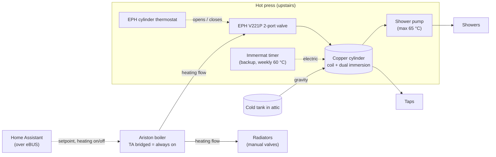
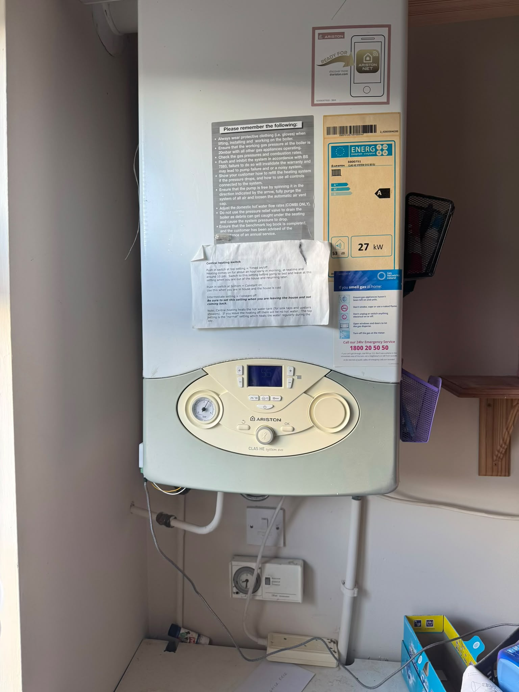
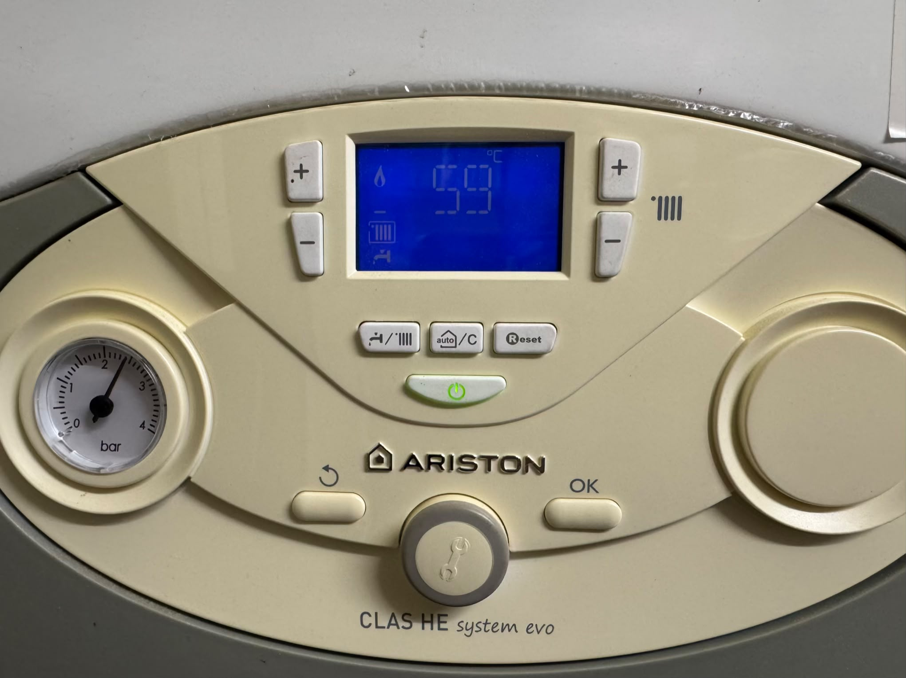
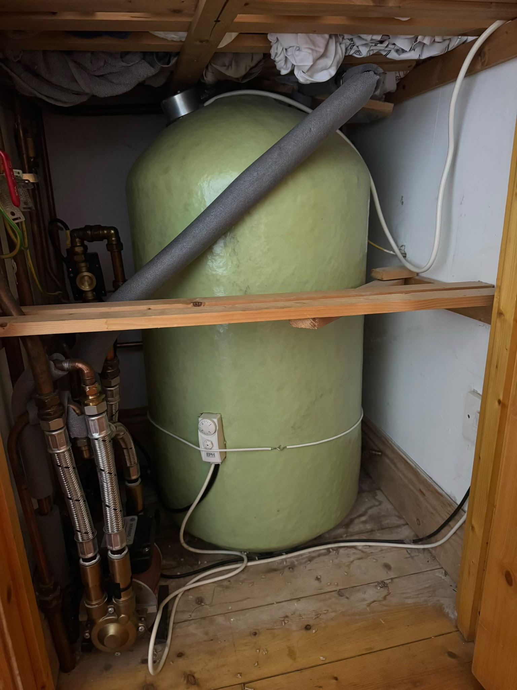
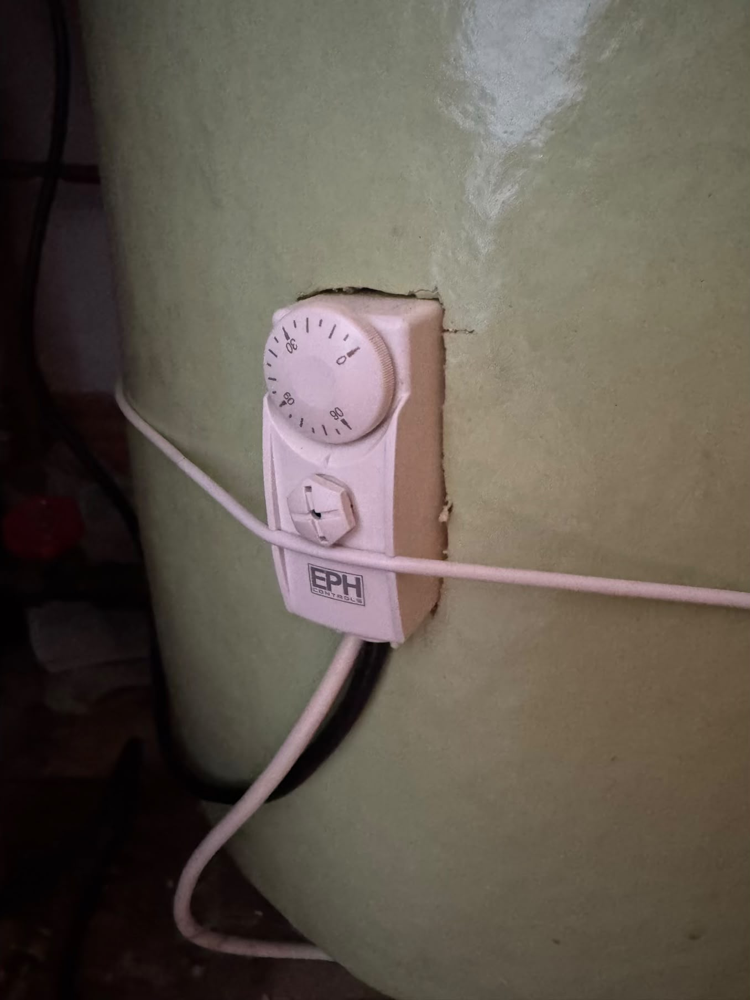
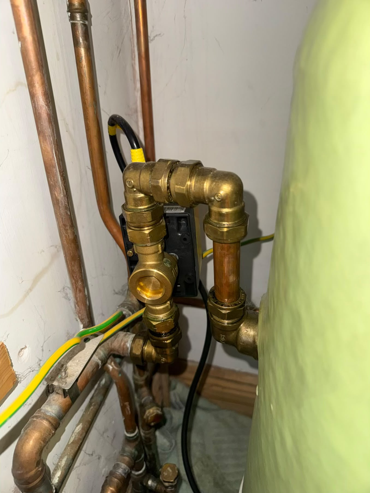
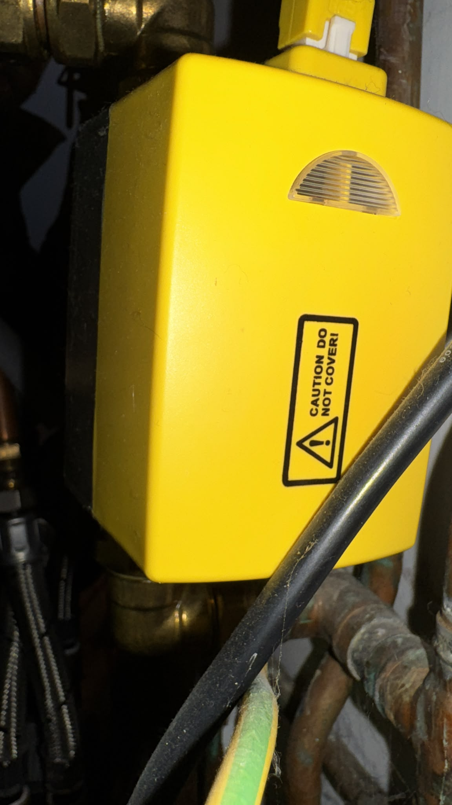
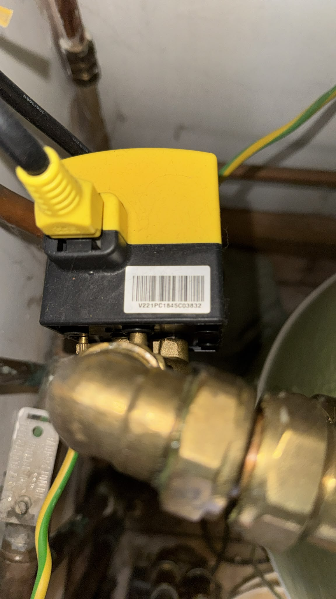
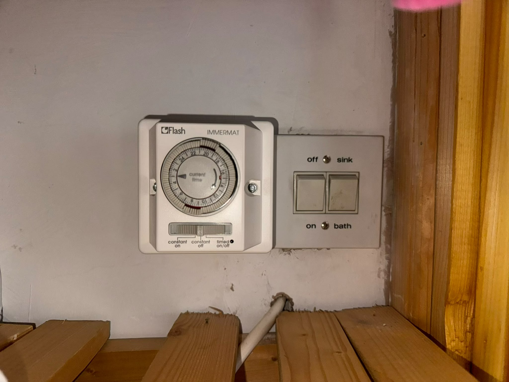
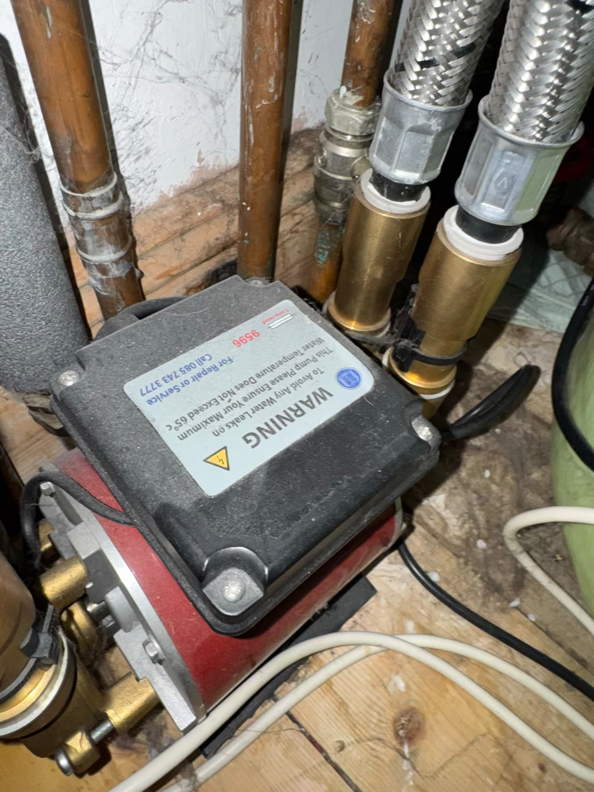

# Example install: the house this was built in

One real setup, written up so you can compare it with yours. Irish semi-detached house, gas boiler downstairs, vented hot
water cylinder in the hot press upstairs, radiators with manual valves, no room thermostat. Your plumbing decides what the
eBUS controls actually do, so check how your hot water is heated before relying on the hot-water switch.



## The boiler



- Ariston **CLAS HE SYSTEM EVO 30 EU** (a *system* boiler: it has a pump and expansion vessel built in, but no hot water of
  its own. It is meant to feed a separate cylinder).
- The eBUS adapter (Shield C5) is wired to the boiler's `BUS` terminals and powered by USB next to the boiler.
- **On/off demand.** There is a mechanical 24 h timer under the boiler, and a printed note on the boiler explains its
  switch (timed / constant on / constant off). But the timer has sat on *constant off* for weeks and the boiler still heats,
  and eBUS shows `heat_request` permanently on, so the timer no longer controls anything. The boiler's room-thermostat
  input (`TA`) is presumably bridged, so the boiler always sees demand and only the setpoint and the heating switch decide
  what happens.



The panel shows the heating setpoint (59 °C here) with both the radiator and tap icons on. See
[register-map.md](register-map.md#front-panel-reference) for what the buttons do.

## Hot water: heated through the heating circuit



- A **copper cylinder with factory foam insulation** in the hot press, fed by gravity from a cold tank in the attic
  (a *vented* system). The attic tank only supplies **tap water**.
- The **radiators and the cylinder's coil are one sealed loop** of their own, pressurised by the boiler (gauge ~1.5-2
  bar, built-in pump and expansion vessel, topped up from the mains through a filling loop). Heating water and tap water
  never mix; the coil passes heat from one to the other.
- The boiler heats it **through the heating pipes**: boiler water runs through a coil inside the cylinder (an *indirect*
  cylinder), like a radiator sitting in the tap water:

  ```
                  hot out to taps / shower pump
                             │
                   ┌─────────┴─────────┐
                   │  hot (top)        │ ← immersion element(s) from the top
                   │                   │
     boiler flow ──┼──╮ ╭─╮ ╭─╮        │ ← copper coil in the tap water
                   │  ╰─╯ ╰─╯ │        │
   boiler return ──┼──────────╯        │   (2-port valve on this loop)
                   │  cool (bottom)    │
                   └─────────┬─────────┘
                             │
                  cold in from attic tank
  ```

  Heat passes through the copper; the two waters never mix. The tank heats from the bottom up and taps draw from the top.
  Heat only flows while the coil is hotter than the water around it, which is why the tank ends up a few degrees below
  the boiler setpoint. To the boiler this is plain heating demand, so:
  - The boiler's own hot-water counters stay at 0 (`diverter_cycles` 0, DHW burner hours 0 after 2,300+ ignitions), its
    left +/- (hot-water setpoint) buttons do nothing, and the **Hot water switch only toggles the tap icon**.
  - **The Heating switch is also the hot-water switch.** Heating off (or summer mode) means no hot water, unless the
    immersion is on.
  - **The cylinder runs about 5-10 °C below the boiler setpoint**, because it is heated through a coil. With a 50 °C
    daytime setpoint expect ~45 °C at the taps.



A strap-on **cylinder thermostat** (EPH, dial 30-90 °C) and a **2-port motorised valve** on the coil pipe: yellow/black
actuator with a plug-in cable and a power-on light, label `V221PC...`, which matches the
[EPH Controls V221P](https://www.screwfix.ie/p/eph-controls-v221p-2-port-motorized-valve-compression/227hp) (3/4"
compression, detachable actuator).

  

So hot water is its own zone: the valve opens while the cylinder is below its thermostat setting (light on) and closes
when it is warm enough, and the boiler then heats only the radiators. Not verified electrically. A controller with a
separate hot-water channel (e.g. a dual-channel Hive) could switch this zone on its own.



**Backup: a dual immersion heater** on a Flash Immermat timer. `sink` heats the top of the tank only, `bath` heats the
whole tank. With the immersion off for days the house still has hot water, which is how we know the boiler is the main
heat source.



A **twin-impeller shower pump** boosts the vented supply. Its label says the water must not exceed **65 °C**.

Other photos: [pipework around the pump](images/hot-press-pipework.jpeg),
[isolation valve and earth bonding](images/hot-press-isolation-valve.jpeg).

## Weekly 60 °C (Legionella)

Legionella bacteria grow in warm, still water (20-45 °C) and cause Legionnaires' disease when breathed in as shower
spray. 60 °C kills them within minutes, so stored hot water should be kept at 60 °C or heated to 60 °C regularly. Because
the boiler only gets this cylinder to ~45-55 °C (and the sliders here stop at 60 °C flow), the simple fix is the
**immersion once a week**: `on` + `bath`, constant on for ~2 hours, then back off. Keep it under 65 °C for the shower
pump. It matters most after the house has stood empty (Away mode).

## Settings used here

| Period | Start | Radiator (flow) temp |
|---|---|---|
| Morning | 06:30 | 57 °C |
| Day | 08:00 | 50 °C |
| Evening | 18:00 | 57 °C |
| Night | 22:00 | 53 °C |
| Away | toggle | 45 °C |

Sliders are limited to 45-60 °C on purpose (the boiler accepts 35-82 °C). Heating and hot water are left on. A Hive
thermostat is planned, which would give real room-temperature on/off control (wired to `TA`).

## If your house differs

- **Your cylinder has a sensor wired to the boiler** (or a combi boiler): the boiler's hot-water side is in use, the left
  +/- buttons work and the Hot water switch really controls hot water.
- **You have a working timer or thermostat on `TA`**: it decides *when* the boiler runs; Home Assistant here only sets
  *how hot* and can turn heating off.
- **No cylinder thermostat or valve**: the cylinder heats whenever the boiler runs and takes whatever the flow temperature
  allows.
